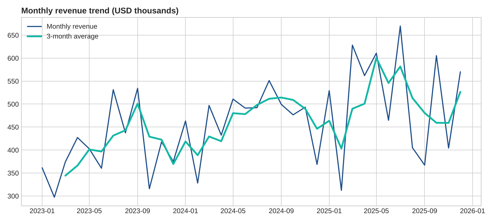
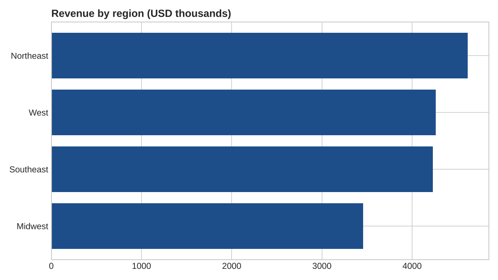
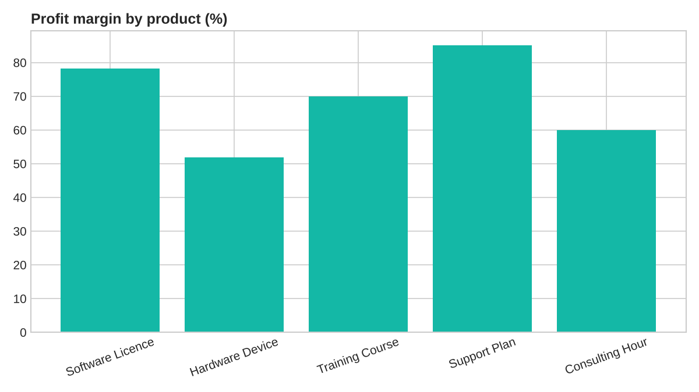
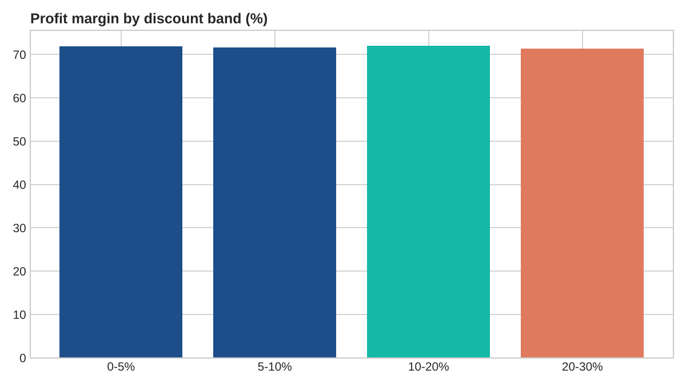

# Sales KPI Dashboard

A business analysis project showing how requirements become a reporting solution: defining KPIs, preparing data, calculating results, and building a Power BI dashboard that stakeholders can use.

**All data in this project is synthetic.** It was generated by `scripts/generate_sales_data.py` and does not come from any real company.

## Business problem

Leadership of a fictional sales organisation needs a single view of revenue, profit and sales performance across regions, channels, products and sales reps. Today the figures are spread across spreadsheets, and numbers often disagree between reports.

## Requirements summary

| # | Stakeholder question | KPI | Where it's answered |
|---|---|---|---|
| 1 | How much revenue and profit are we making? | Total revenue, total profit | Executive summary |
| 2 | Are we growing, and is the trend healthy? | Revenue YoY %, 3-month average | Monthly trend |
| 3 | Which regions and channels drive results? | Revenue share, profit margin % | Sales performance |
| 4 | Which products and reps perform best? | Revenue and margin by product and rep | Sales performance |
| 5 | Do deeper discounts still earn profit? | Margin by discount band | Pricing and discounts |

Full acceptance criteria are in `docs/requirements.md`.

## KPI definitions

- **Total revenue**: sum of `revenue` (quantity × unit price, after discount).
- **Total profit**: sum of `profit` (revenue minus cost).
- **Profit margin %**: total profit ÷ total revenue.
- **Average order value (AOV)**: total revenue ÷ number of orders.
- **Revenue YoY %**: change in revenue compared with the same period in the prior year.

## Data

`data/sales_orders.csv` contains 6,000 orders from January 2023 to December 2025. The data dictionary is in `docs/data_dictionary.md`.

## Headline results

These figures come from `data/kpi_headline.csv` and `data/kpi_yearly_summary.csv`:

| Year | Revenue | Profit margin | Revenue growth |
|---|---|---|---|
| 2023 | $4.83M | 72.6% | — |
| 2024 | $5.60M | 71.8% | +15.9% |
| 2025 | $6.13M | 71.2% | +9.4% |

Over the three years, revenue totals $16.57M, profit totals $11.89M, and the average order value is $2,761.

**What the numbers suggest:** revenue grew each year, but profit margin dipped slightly each year. Growth is coming with a small margin cost, which is worth investigating before the next pricing decision.

**Discount check:** margin barely changes across discount bands (about 71–72% in every band). In this synthetic data, deeper discounts don't reduce margin. A real analysis would need to test that with real data before drawing any conclusion.

## Charts






## Power BI dashboard

The interactive dashboard is built in Power BI Desktop. Follow `docs/powerbi_build_guide.md` to build it from the CSV files and the DAX measures in the guide.

## Project structure

```
data/        sales_orders.csv and KPI summary tables
scripts/     generate_sales_data.py, calculate_kpis.py
images/      charts used in this README
docs/        requirements, data dictionary, Power BI build guide
```

## How to run

```bash
pip install pandas matplotlib numpy
python3 scripts/generate_sales_data.py   # optional: regenerate the dataset
python3 scripts/calculate_kpis.py        # recalculate KPIs and charts
```

## What I'd do next

- Add a date-based forecast of monthly revenue.
- Add data quality checks, such as reconciling totals against an independent source.
- Write UAT test cases for each KPI, then document any defects found.
